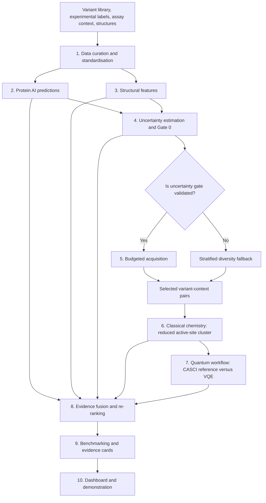

# Q-Catalyst

**Context-aware, mechanism-informed prioritisation of PETase variants using protein AI, uncertainty-guided computational chemistry, and quantum-chemistry validation.**

> **Project status:** Role 1 has model, prediction, uncertainty, Gate 0, and benchmark modules, plus an end-to-end real-weight runner on branch `feature/role1-end-to-end-pipeline`. The branch adds integration regression tests, a fail-safe Gate 0 policy bridge, and a run manifest. A fresh end-to-end run on the target machine is still required before calling the integrated branch verified. Existing result files and reports may be snapshots from prior runs; use `docs/role1_pipeline_runbook.md` and `reports/role1_pipeline_run.json` to reproduce and verify the current pipeline. A successful software run does not establish a biological improvement or quantum advantage.

## 1. Overview

Protein engineering can produce many candidate enzyme variants, but experimentally testing every candidate is costly. Protein AI can help rank candidates, yet a prediction may be unreliable for variants or assay conditions that differ from the training data. Classical computational chemistry can add mechanistic evidence, but detailed calculations are also expensive. Quantum algorithms such as the Variational Quantum Eigensolver (VQE) provide a way to investigate selected small electronic-structure problems, but they must be validated against an appropriate classical reference.

**Q-Catalyst is designed to test whether uncertainty-guided, selective mechanistic computation improves PETase variant prioritisation enough to justify its computational cost.** It combines:

1. Curated PETase variant and assay data.
2. Protein-language-model scores and supervised predictions.
3. Structural features and uncertainty estimates.
4. A budgeted acquisition gate that selects a subset for additional computation.
5. Classical chemistry calculations on a reduced active-site cluster.
6. A small active-space quantum workflow, validated against a matching exact classical calculation.
7. Evidence fusion, benchmark comparisons, and a dashboard with traceable candidate evidence.
8. An optional, bounded multi-agent review layer that challenges interpretations of existing evidence without duplicating or inventing calculations.

The main outcome is a ranked list of **experimentally testable candidates**, accompanied by the evidence, uncertainty, computational cost, and limitations behind each recommendation. Without prospective wet-lab testing, the project cannot claim that a predicted variant is experimentally improved.

## 2. Project goals

### Primary goals

- Build a reproducible data-to-ranking pipeline for PETase variants.
- Predict activity and, where compatible labels are available, thermostability.
- Quantify predictive uncertainty and test whether it identifies larger prediction errors.
- Select a budget-limited subset of candidates for classical chemistry.
- Compare classical chemistry descriptors with an AI-only baseline.
- Validate VQE against an exact classical reference for the same active-space Hamiltonian.
- Measure ranking quality, uncertainty calibration, compute cost, and the added value (or lack of value) of chemistry.
- Present context-specific recommendations with clear provenance and uncertainty.

### Non-goals and scientific boundaries

- **No claim of quantum advantage.** The proposed small active spaces are small enough for exact classical reference calculations. The quantum layer measures implementation readiness, numerical error, circuit resources, and noise sensitivity.
- **No whole-protein VQE.** Quantum calculations target a small active-space problem derived from a reduced molecular cluster, not the entire PETase protein.
- **No claim of wet-lab validation.** Retrospective evaluation on public data can test recovery and ranking performance; it cannot prove a newly proposed variant improves PET degradation.
- **No unsupported activity claims from a cluster energy.** Cluster descriptors are mechanistic proxies, not direct measurements of enzyme activity or reaction free-energy barriers.
- **No automatic trust in agent debate.** Agents may analyse and challenge recorded evidence; they cannot make a failed calculation valid or replace missing experimental evidence.
- **No tuning on the final test set.** Model and acquisition choices must be made using the prescribed training/validation procedure.

## 3. High-level architecture



### A context-aware candidate

A candidate should not be treated as universally “good” or “bad.” Where the source data support it, the system should associate each variant with an explicit experimental context, including:

- Parent enzyme and variant sequence.
- Mutation list and residue-numbering convention.
- Assay/study identifiers and publication source.
- Activity measurement, units, and measurement type.
- Temperature, pH, substrate form/crystallinity, enzyme loading, reaction time, buffer, and assay method when reported.
- Structure identifier and relevant structural state.
- Data-quality flags and missingness indicators.

Not every dataset contains all fields. Missing context must remain missing or be labelled as inferred; it must not be silently invented. Do not pool raw activity measurements from different studies without assessing assay comparability. Prefer relative-to-parent measurements from the same assay when suitable.

## 4. The four workstreams

### Role 1 — Protein ML Lead

**Owns:** data curation, protein AI, uncertainty, Gate 0, AI-only benchmark arms, and metric calculations.

**Main inputs:** PET-Gym/PET-Flow data, compatible activity and thermostability labels, PAZy and literature resources, protein sequences, structures, and agreed file contracts.

**Work performed:**

- Audit dataset licences, sources, assay labels, duplicates, and quality.
- Standardise sequence and mutation representations.
- Map parent-enzyme mutation positions to the reference structure numbering with alignment and sanity checks.
- Generate ESM-1v zero-shot scores and/or ESM-2 embeddings.
- Train lightweight predictors (for example, Ridge/Elastic Net or XGBoost) where labels support training.
- Create structural features in collaboration with Roles 2 and 4.
- Estimate uncertainty using ensemble disagreement, conformal intervals, out-of-distribution signals, structural risk, and assay mismatch.
- Run Gate 0 and document whether uncertainty is useful for selection.
- Evaluate AI-only arms A0–A2 and later score chemistry/quantum arms using the common metric implementation.

**Main outputs:**

- `variants.parquet`
- `predictions.parquet`
- `uncertainty.parquet`
- Mutation-to-5XJH mapping and eligible-variant counts.
- Gate 0 report and AI-only benchmark results A0–A2.
- SHAP/explanation outputs where appropriate.

**Failure fallback:** if ESM is too slow, test a smaller model or CPU-friendly path. If Gate 0 fails, report it and switch selection to the approved diversity-only fallback.

### Role 2 — Computational Chemistry Lead

**Owns:** structure preparation, protonation, substrate/cluster construction, electrostatic embedding, PySCF calculations, descriptors, sensitivity analysis, and the classical CASCI reference.

**Main inputs:** Role 1’s mutation list and 5XJH mapping, Role 4’s ordered `chem_jobs.json`, agreed chemistry budget, and reference structures (including 5XJH and, where relevant, 7SH6).

**Work performed:**

- Prepare and inspect the enzyme structure and the modelled substrate pose.
- Build a reduced active-site cluster around the catalytic triad (IsPETase 5XJH numbering: Ser160, His237, Asp206), oxyanion-hole donors, and PET-ester model.
- Document protonation, geometry, capping, and embedding assumptions.
- Run small HF/DFT calculations using PySCF and verify convergence.
- Compute mutation-sensitive descriptors, including relevant distances, charges, electrostatic potential, interaction-energy proxies, and approach-profile values.
- Run identical settings for wild type and mutant except for the intended mutation; record sensitivity to reasonable method/geometry choices.
- Provide the same cluster, embedding and orbitals needed by Role 3 for a matched active-space calculation.

**Main outputs:**

- `chem_results.parquet`
- Cluster geometries, embedding charges, converged orbitals and reproducible CASCI inputs for Role 3.
- Per-job runtime/cost and sensitivity-analysis report.

**Scientific boundary:** a reduced cluster does not capture the full enzyme, dynamics, entropy, or solvent reorganisation. Single-point energies are not automatically free energies or reaction barriers. Mutations outside the cluster’s effective scope may be invisible.

### Role 3 — Quantum Lead

**Owns:** active-space selection, PySCF-to-qubit Hamiltonian bridge, VQE, exact-reference comparison, noise analysis, and the PennyLane fallback.

**Main inputs:** Role 2’s cluster, embedding, orbitals and CASCI reference; Role 4’s selected subset, quantum budget and agreed result schema.

**Work performed:**

- Validate the software bridge on small reference systems before using an enzyme-derived cluster.
- Start with a small active space (the plan targets `(4e, 4o)` if feasible).
- Map the active-space Hamiltonian to qubits and run VQE on a simulator.
- Compare VQE and CASCI for the **same** active space, geometry, and embedding.
- Record energy errors, convergence, iterations, qubit count, circuit depth, two-qubit-gate count, runtime, shots, noise model, and seeds.
- Perform a noise sweep and compare noiseless and noisy runs.
- Maintain a smaller/alternative implementation fallback, including PennyLane where feasible.
- Prepare a small VQE live-demo script plus a precomputed backup.

**Main outputs:**

- `quantum_results.parquet`
- VQE-versus-CASCI parity plots, noise and resource analyses.
- Working small-system demonstration and fallback.

**Scientific boundary:** small simulated VQE is not evidence of quantum advantage. If noiseless VQE materially disagrees with the exact CASCI reference, investigate the Hamiltonian bridge, ansatz, and optimiser before interpreting the result.

### Role 4 — Integration, UI and Pitch Lead

**Owns:** repository and shared interfaces, acquisition gate, budget coordination, evidence fusion, dashboard, 3D viewer, pre-registration, end-to-end demo, pitch and Q&A.

**Main inputs:** outputs from Roles 1–3, candidate eligibility counts, computation timing, budget limits, and the team’s pre-registered evaluation plan.

**Work performed:**

- Maintain the repository, file contracts, environment lockfile and integration tests.
- Define and commit `prereg.md` before inspecting chemistry outcomes.
- Apply the structural proximity filter and acquisition function to select a budgeted batch.
- Send the ordered job list to Role 2 and the corresponding subset to Role 3.
- Fuse AI and chemistry evidence (for example, regularised residual learning), define utility/constraints and confidence tiers, and flag prior art.
- Produce `ranking.parquet`, evidence cards, and the Streamlit dashboard.
- Ensure the demo uses cached results for expensive calculations and has a fallback recording.
- Coordinate final benchmark reporting and the pitch.

**Main outputs:**

- `chem_jobs.json`
- `ranking.parquet` and evidence-card JSON.
- `prereg.md` and reproducibility records.
- Streamlit dashboard, mutation viewer, demo script, presentation and Q&A materials.

## 5. Data flow and file contracts

The team must agree on these contracts before parallel implementation begins. Column names should not be changed silently; version changes should be recorded and adapters provided when needed.

| File | Owner | Purpose and expected key fields |
|---|---|---|
| `variants.parquet` | Role 1 | One record per variant/context observation; stable variant/parent/study IDs, sequence, mutations, activity and unit, relative activity where justified, `Tm_C`/`dTm_vs_parent` where available, assay conditions, structure mapping, data-quality flags and source. |
| `predictions.parquet` | Role 1 | Variant/context IDs, predicted activity and/or ΔTm, interval bounds, model ID/version, split ID, prediction status. |
| `uncertainty.parquet` | Role 1 | Variant/context IDs, aggregate uncertainty `U`, component signals, calibration status, Gate 0 status and selection-relevant flags. |
| `chem_jobs.json` | Role 4 | Ordered job IDs, variant/context IDs, selection arm, reason, priority, chemistry budget and requested method/cluster tier. |
| `chem_results.parquet` | Role 2 | Job/variant/context IDs, cluster definition, descriptor values, WT/mutant comparison, method, basis, protonation/rotamer information, convergence/failure, runtime, basis-function count and provenance. |
| `quantum_results.parquet` | Role 3 | Job/variant/context IDs, active-space definition, CASCI/VQE energies, energy error, qubits, circuit depth, two-qubit gates, optimiser, iterations, shots/noise settings, runtime and provenance. |
| `ranking.parquet` | Role 4 | Variant/context IDs, AI-only rank, chemistry/quantum evidence status, final score/rank, confidence tier, selection reason, cost, prior-art status and abstention/limitations flags. |
| `benchmark_results.parquet` | Roles 1 + 4 | Arm, split, metric, value, confidence interval, bootstrap settings, compute cost, sample count and result provenance. |

### Shared file rules

- Use a stable `variant_id`, and retain `parent_enzyme`, `study_id`, `assay_id` and `context_id` wherever applicable.
- Keep parent-sequence mutation numbering separate from 5XJH structure numbering.
- Record units explicitly; do not treat raw activity units from incomparable assays as interchangeable.
- A failed, skipped, unavailable, or unconverged calculation is **not** a zero value. Represent status and missingness explicitly.
- Keep measured, predicted, and simulated quantities distinguishable in data and UI.
- Include source path/URL or publication, data version/hash, code commit, software versions, relevant parameters, seed, and runtime wherever applicable.
- Save large datasets, model weights, caches, and generated result files outside normal Git tracking unless there is an explicit reason to version them.

## 6. Acquisition and budget gate

The acquisition module selects candidates for classical chemistry; it should not send every variant to expensive calculations.

The proposal’s initial heuristic is:

\[
a(x)=\lambda U(x)+\eta P(x)+\mu D(x)-\nu C(x)
\]

where:

- `U(x)` is the uncertainty score.
- `P(x)` is predicted performance or expected value.
- `D(x)` represents diversity or information value.
- `C(x)` is estimated computational cost.
- The terms must be scaled consistently before combining them.

Starting weights in the work plan are `λ = 0.4`, `η = 0.3`, `μ = 0.2`, and `ν = 0.1`. Treat these as initial heuristic settings, not a proven optimum; tuning must use the agreed validation procedure only.

The structural eligibility filter starts at `R = 8 Å` and should be tested for `R = 6, 8, 10, 12 Å`. A candidate may be eligible if a mutated residue is sufficiently close to the catalytic Ser Oγ or modelled substrate ester carbon, or is in the substrate-binding cleft according to the shared rule. The eligible count and exact rule must be recorded. Variants excluded from chemistry still retain the AI ranking.

If Role 1’s Gate 0 indicates that uncertainty is not informative, Role 4 should switch to the agreed diversity-only selection rule and report the result honestly. The acquisition score remains a heuristic unless a formal value-of-information method is implemented.

## 7. Benchmark plan

All benchmark arms should use the same eligible pool, splits, metric code and comparable budgets where relevant. The proposed arms are:

| Arm | Strategy | Owner/contribution |
|---|---|---|
| A0 | Random ranking/selection floor | Role 1 defines the baseline; Role 4 integrates. |
| A1 | ESM-1v zero-shot score | Role 1. |
| A2 | Supervised AI plus structural features | Role 1; main AI baseline. |
| A3 | AI plus random eligible classical-chemistry batch | Role 2 provides chemistry; Role 1/4 evaluate. |
| A4 | AI plus uncertainty-gated classical chemistry | Roles 1, 2 and 4. |
| A5 | AI plus exact CASCI control | Roles 2 and 3; Role 1/4 evaluate. |
| A6 | AI plus noiseless VQE | Role 3; Role 1/4 evaluate. |
| A7 | AI plus noisy VQE | Role 3; Role 1/4 evaluate. |

The exact definition of each arm, budget, split, seed, “good variant” threshold, and statistical procedure must be written in `docs/prereg.md` before chemistry results are reviewed.

### Metrics

The plans identify `Precision@10` and Value of Chemistry (VoC) as primary measures, with Precision@5/@20, enrichment factor, NDCG@K, Spearman/Kendall rank correlation, search-space reduction, and chemistry evaluations avoided as complementary metrics.

The planned VoC is:

`VoC = (metric(strategy) - metric(A2)) / chemistry_CPU_hours`

Interpret it with the underlying metric, budget and uncertainty interval; do not use it to hide a negative or unstable result. Compare arms with paired bootstrap intervals on identical splits. Report effect sizes and confidence intervals, not only p-values.

## 8. Uncertainty validation: Gate 0

Role 1 owns the uncertainty hypothesis: the uncertainty score should contain information about where the AI model makes large errors.

The plan calls for held-out evaluation of:

1. Spearman correlation between uncertainty `U` and absolute prediction error, with a bootstrap 95% confidence interval.
2. AUROC for identifying the worst-error quartile.
3. Conformal interval coverage/calibration diagnostics.

If the confidence interval for the uncertainty/error correlation includes zero, the pre-specified H1 criterion is not met. Report that result and switch to diversity-only gating. Do not tune the gate using the frozen test set or present the uncertainty signal as validated when it has failed the criterion.

## 9. Multi-agent review (optional architecture extension)

The `agents/` module is an optional context-aware evidence-review layer. It should be added only after the scientific pipeline and shared contracts are functioning.

Proposed specialist roles:

- **Context specialist:** checks assay comparability, metadata completeness and source provenance.
- **Structural specialist:** interprets mutation location and structural evidence.
- **Classical-chemistry specialist:** reviews the validity and limits of PySCF descriptors.
- **Quantum specialist:** reviews active-space setup, CASCI/VQE agreement, convergence and noise.
- **Prediction/uncertainty critic:** checks model predictions, calibration, out-of-distribution warnings and conflicting signals.
- **Coordinator/adjudicator:** assembles reports, runs bounded critique, records unresolved disagreement and produces a context-specific decision record.

Recommended debate limits: independent assessments, one structured critique round, and at most one rebuttal/resolution round. The coordinator must use evidence quality and provenance rather than majority vote, and it must be allowed to return “insufficient evidence.”

Agents should read validated, shared results instead of independently rerunning chemistry. Any new calculation request must pass through the same acquisition/budget mechanism. Agent-generated claims must reference evidence IDs; synthetic examples must be marked as synthetic. If the agentic layer is incomplete, the core Tier 1 scientific demonstration must still work without it.

## 10. Dashboard and evidence cards

Role 4’s planned Streamlit app has seven pages:

1. **Input:** select/upload a parent sequence and variant library.
2. **Mutation map:** structure view with the catalytic triad, oxyanion hole, mutated residues, distances and eligibility outcome.
3. **Predictions and uncertainty:** activity/ΔTm prediction intervals and uncertainty-signal breakdown.
4. **Gate explanation:** why a variant was selected for chemistry, or why it received AI ranking only.
5. **Chemistry evidence:** descriptors versus wild type, VQE-versus-CASCI comparison and noise results.
6. **Final ranking:** top 5–10 evidence cards with confidence tiers and prior-art flags.
7. **Benchmark:** arm comparison with confidence intervals and value-of-chemistry versus compute cost.

Each evidence card should display candidate and mutation identifiers, context, structure mapping, AI prediction and interval, uncertainty breakdown, chemistry status/descriptors, quantum validation status, final score/tier, reason for selection, source/provenance and limitations. Include a statement that the candidate is computationally prioritised and not experimentally validated.

The dashboard must consume cached results; it should not wait for a full chemistry or VQE calculation during the live demonstration. Keep a tested backup for the small live VQE moment.

## 11. Repository layout

```text
qcatalyst/
├── README.md
├── pyproject.toml
├── environment.yml
├── .gitignore
├── configs/
├── docs/
├── data/
│   ├── raw/
│   ├── curated/
│   ├── splits/
│   └── structures/
├── src/qcatalyst/
│   ├── data/                 # Role 1
│   ├── protein_ai/           # Role 1
│   ├── structure/            # Shared
│   ├── uncertainty/          # Role 1
│   ├── acquisition/          # Role 4
│   ├── chemistry/            # Role 2
│   ├── quantum/              # Role 3
│   ├── fusion/               # Role 4
│   ├── agents/               # Optional evidence review
│   ├── evaluation/           # Roles 1 and 4
│   └── dashboard/            # Role 4
├── tests/
├── scripts/
├── results/
├── reports/
└── env/
```

Suggested conventions:

- `configs/` contains shared settings; avoid duplicating constants across modules.
- `docs/interface_contracts.md` contains the authoritative schemas and contract versions.
- `docs/scientific_decisions.md` records decisions and their rationale.
- `docs/prereg.md` records the evaluation plan and its commit hash before chemistry outcomes are reviewed.
- `data/raw/` contains licensed/source inputs; `data/curated/` holds cleaned tables; `data/splits/` contains frozen split assignments.
- `results/` and model/cache outputs should usually be ignored by Git; distribute them through approved project storage when needed.
- `reports/` contains generated figures, tables and the final technical report.
- `env/` records the model cache locations, version manifest, checksums and offline-readiness status; do not commit large weights or secrets.

## 12. Setup and development workflow

### Prerequisites

- Git.
- A consistent, team-approved Python version (the role plans propose Python 3.10–3.12; select and pin one tested version).
- Conda/Mamba or another agreed environment manager.
- Access to the approved datasets and pretrained model weights.
- PySCF for classical electronic-structure calculations.
- Qiskit, Qiskit Nature, Qiskit Aer, and the compatible chemistry integration for the primary VQE path; PennyLane is the planned fallback.
- A Linux environment or WSL2 is recommended for PySCF on Windows. Use the college workstation for heavier calculations when necessary.

### First clone

```bash
git clone <TEAM_REPOSITORY_URL>
cd qcatalyst
```

Replace `<TEAM_REPOSITORY_URL>` with the team's actual repository URL. Do not invent or commit credentials.

### Environment setup

`environment.yml` and `pyproject.toml` are initially scaffolding files until the team populates them with tested, compatible dependencies. Once `environment.yml` contains the agreed environment, create it with:

```bash
conda env create -f environment.yml
conda activate qcatalyst
```

After installation, record exact package versions in `env/version_manifest.txt`. Run the small H₂ chemistry and VQE/CASCI bridge tests before starting any enzyme-derived calculation. Do not install every optional scientific package into one untested environment at once; resolve and pin compatible versions as a team.

### Development workflow

1. Pull the latest `main` branch.
2. Create a branch for one module or feature (for example, `feature/uncertainty-gate`).
3. Implement the agreed interface and add a focused test.
4. Run the relevant tests and a small smoke test.
5. Commit code and documentation, not large generated datasets or model weights.
6. Open a pull request, review it, then merge to `main`.
7. Do not change shared Parquet/JSON schemas without updating the interface contract, tests and dependent adapters.

Example commands:

```bash
git switch -c feature/my-module
git status
git add src/ tests/ docs/
git commit -m "Implement <module> interface"
git push -u origin feature/my-module
```

The implementation and test commands will become runnable as the scaffold files are populated. Until then, this README describes the intended workflow, not a guarantee that a full pipeline can already execute.

## 13. Compute strategy

- **Local laptops:** code, review data, run unit tests, train small classical models, build plots, and test small H₂/VQE examples.
- **College workstation:** larger ESM embedding batches, repeated inference, PySCF jobs and larger simulator runs, subject to its policy and available memory/GPU.
- **Cache expensive outputs:** embeddings, structural features, chemistry results and quantum outputs should be reused when input hashes and calculation settings match.
- **Keep jobs bounded:** record per-job runtime and stop expensive optional work if it threatens the Tier 1 demonstration.
- **Use CPU-compatible fallbacks:** a GPU accelerates protein inference but is not a requirement for all modules; test ESM runtime early and use a smaller model if needed.
- **Remote work:** SSH/VS Code Remote-SSH can be used only where college IT permits it. Do not expose a workstation or SSH service publicly to bypass network policy.

## 14. MVP tiers and priorities

The project plan uses three tiers to prevent scope creep.

### Tier 1 — Must demonstrate

- Curated data and sequence/structure mapping.
- ESM scoring and a supervised predictor with prediction intervals.
- Gate 0 result and fallback behaviour.
- Structural proximity filter and budgeted candidate acquisition.
- Tier S classical chemistry on a small selected subset (the integration plan targets at least 10 variants if the compute budget permits).
- At least one `(4e, 4o)` VQE run compared with CASCI on the same active-space problem.
- Dashboard that loads cached results and clearly explains the evidence.

### Tier 2 — Should demonstrate if time allows

- Broader A0–A6 benchmark comparison with intervals.
- Noise sweep and sensitivity analyses.
- Value-of-chemistry analysis.
- Stronger evidence cards and 3D mutation viewer.

### Tier 3 — Stretch only

- A full active-learning iteration.
- Larger Tier M cluster calculations.
- Error mitigation, ADAPT-VQE, QAOA experiments or real-hardware runs.

Do not allow Tier 3 tasks to block Tier 1. If the core pipeline is not working at the agreed final-quarter checkpoint, stop adding features and stabilise the demo.

## 15. Testing and definition of done

### Software tests

- Data schema tests detect missing required columns, duplicate keys, invalid residue notation and inconsistent units.
- Small toy fixtures exercise each module without downloading large models or running long chemistry calculations.
- Structure mapping tests verify known residues and the catalytic triad in 5XJH reference numbering.
- Model tests use fixed seeds/splits and ensure outputs are finite and have the expected IDs/shapes.
- Chemistry tests start with reference molecules (H₂, LiH, H₂O and a hydrogen-bonded dimer where feasible) and check convergence and units.
- Quantum tests check the PySCF-to-Qiskit/PennyLane bridge; noiseless VQE should agree with the exact reference within a declared numerical tolerance for the same Hamiltonian.
- Integration tests verify joins across variant, chemistry, quantum and ranking outputs; failed/missing results must not become zero values.
- Dashboard tests should confirm it loads cached example results and provides a useful fallback when optional modules are missing.

### Scientific checks

- Confirm data licences, provenance and assay compatibility.
- Freeze identity-/study-/scaffold-aware data splits and seeds before tuning.
- Use nested or training-only cross-validation for model/acquisition tuning.
- Report uncertainty calibration and Gate 0 result, including failure if the criterion is not met.
- Compare all arms with the same metric implementation, splits and paired bootstrap procedure.
- Report effects and confidence intervals, runtime and costs, not just point estimates.
- Run known-winner recovery with published strong candidates withheld where the dataset allows it.
- Freeze final outputs, record the Git commit hash and software versions, and keep a reproducible run record.

## 16. Data sources and references

These are the sources named in the work plans. Check current availability, terms of use, version and required citation before reuse.

- **PET-Flow / PET-Gym:** <https://github.com/pet-flow815/petflow>
- **PETML:** <https://github.com/jafetgado/PETML>
- **PAZy — Plastics-Active Enzymes Database:** <https://www.pazy.eu/>
- **ML-guided PET hydrolase identification dataset (Zenodo record named in the work plan):** <https://doi.org/10.5281/zenodo.15417757>
- **IsPETase structure 5XJH:** <https://www.rcsb.org/structure/5XJH>
- **FAST-PETase structure 7SH6:** <https://www.rcsb.org/structure/7SH6>
- **ESM models:** <https://github.com/facebookresearch/esm>
- **PySCF:** <https://pyscf.org/>
- **Qiskit Nature:** <https://qiskit-community.github.io/qiskit-nature/>
- **Qiskit Algorithms:** <https://qiskit-community.github.io/qiskit-algorithms/>
- **MAPIE:** <https://mapie.readthedocs.io/>
- **scikit-learn:** <https://scikit-learn.org/>
- **XGBoost:** <https://xgboost.readthedocs.io/>
- **SHAP:** <https://shap.readthedocs.io/>
- **Streamlit:** <https://docs.streamlit.io/>
- **OpenMM:** <https://openmm.org/>
- **AutoDock Vina:** <https://vina.scripps.edu/>
- **PROPKA:** <https://github.com/jensengroup/propka>

The work plans list the PET-Flow/PET-Gym source as a preprint and flag dataset licences, downloads and some references for verification. Record the exact dataset release and hash used in the project; do not assume that a public website automatically permits every reuse.

## 17. Reproducibility checklist

Before a result is presented as part of the final project, record:

- [ ] Data source, release/version, licence review and file hash.
- [ ] Code commit hash and configuration.
- [ ] Model/method and package versions.
- [ ] Input variant/context IDs and structure/cluster definition.
- [ ] Data split and random seed.
- [ ] Key model, chemistry, active-space or simulator parameters.
- [ ] Runtime, compute cost and status (success, failed, skipped, unconverged).
- [ ] Metrics with confidence intervals and the relevant baseline.
- [ ] Scientific limitations and whether the evidence is experimental, predicted or simulated.

## 18. Final project message

Q-Catalyst uses AI to screen broadly, uncertainty to identify where additional evidence may be useful, classical chemistry to study a selected subset, and a VQE workflow with an exact classical control to measure quantum-algorithm behaviour. It then evaluates whether the extra computation improves ranking quality enough to justify its cost.

The project succeeds scientifically if it produces reproducible evidence about **when the extra computation helps, when it does not, and how confidently the team can defend each candidate recommendation**—not if it claims quantum advantage without evidence.
